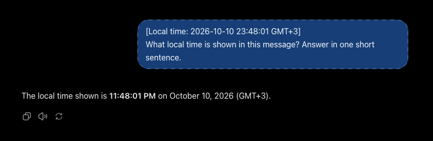
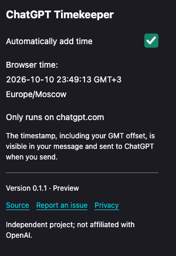

# ChatGPT Timekeeper

**Give ChatGPT a little context about when you're writing.**

Timekeeper adds your local date and time to each message you send on [chatgpt.com](https://chatgpt.com). Handy for planning your day, keeping a journal, or talking about “today” and “tomorrow”.



## What it does

Write your message and send it as usual. Timekeeper adds one line at the top:

```text
[Local time: 2026-10-10 23:38:30 GMT+3]
Help me plan tomorrow morning.
```

The time comes from your computer. The GMT offset tells ChatGPT which local time you're using. You can turn timestamps off at any time from the extension popup.



No account with us, no ads, no analytics. Your message and timestamp go to ChatGPT when you send; the extension keeps no chat history. [Privacy policy](PRIVACY.md).

## Try it

This is an early preview for desktop **Chrome and Firefox**. It isn't in the extension stores yet.

To try the current source, download or clone this revision, install [Node.js](https://nodejs.org/) 22 or later, then run this in the project folder:

```sh
npm run package
```

**Chrome:** open `chrome://extensions`, turn on Developer mode, choose **Load unpacked**, and select `dist/chromium`.

**Firefox:** open `about:debugging#/runtime/this-firefox`, choose **Load Temporary Add-on…**, and select `dist/firefox/manifest.json`. You'll need to load it again after restarting Firefox.

Reload your ChatGPT tab, pin the extension if you like, and send a message. The popup shows a time preview and the on/off switch.

You can also download the [published preview](https://github.com/AlexS778/chatgpt-timekeeper/releases/tag/v0.1.0-preview.2). That older version uses the longer timestamp format; the shorter format shown here is in the unreleased 0.1.2 source.

**A couple of things to know:** stop dictation before sending. This preview works with ordinary text messages, and ChatGPT interface changes may affect it. Safari, mobile browsers and native apps aren't supported. More testing is still needed before a regular store release.

[Report a problem](https://github.com/AlexS778/chatgpt-timekeeper/issues) · [Source](https://github.com/AlexS778/chatgpt-timekeeper) · [MIT license](LICENSE)

Independent project; not affiliated with or endorsed by OpenAI.

---

<details>
<summary><strong>Technical details, test evidence and release notes</strong></summary>

The readable-format change passed 21 unit/source checks and 64 Firefox/Chromium fixtures. The screenshots above come from the installed Firefox extension and an actual temporary ChatGPT chat; [capture details and the limited real-site check](docs/READABLE_TIMESTAMPS.md) are recorded separately from the earlier compatibility matrix.

**Development preview, tested in desktop Firefox and Chrome.** On 2026-10-10, the packaged extension passed real ChatGPT pointer Send-click, composer Enter, multiline Unicode/code, Shift+Enter and live off/on toggle checks in Firefox 157.0.1 (signed in) and Chrome 153.0.8010.36 (signed out and signed in). Signed-in Firefox and Chrome also passed new-chat navigation checks. The Chrome focused Send-button bug was subsequently fixed and verified with the installed extension in both browsers; the remaining acceptance matrix is pending. Test evidence is in [docs/FEASIBILITY.md](docs/FEASIBILITY.md). Safari and mobile are outside this preview. This is not a production compatibility guarantee.

## Preview release

The published preview is tagged **`v0.1.0-preview.2`**; its WebExtension manifest and package use numeric version **`0.1.0`**. Release notes: [docs/releases/v0.1.0-preview.2.md](docs/releases/v0.1.0-preview.2.md). This project is independent and is not affiliated with or endorsed by OpenAI.

The unsigned Chromium and Firefox ZIPs contain the extension files with `manifest.json` at the archive root. Extract the matching ZIP into its own directory, then load that directory using the browser instructions below (Firefox selects its `manifest.json`). They are local testing packages, not signed store installs. The current source prepares the **unreleased 0.1.2** store-readiness candidate (`v0.1.2-preview.1`); the published 0.1.0 ZIPs are unchanged. To reproduce the published assets, check out `v0.1.0-preview.2` first. To build the current candidate, run `npm run release` with Node 22+ and Python 3.9+; output and SHA-256 checksums are in `dist/release/`. [Release preparation](docs/RELEASING.md) explains verification and publication.

### Known limitations

- **Active dictation is unsupported.** Stop dictation before Send so the transcript enters the ordinary composer. The reported Firefox behavior and investigation TODO remain open.
- **Production acceptance is incomplete.** Real-site IME, attachment-only, long-draft, failure/retry and undo checks remain pending across the claimed browsers; fixture coverage does not establish real-site acceptance.
- **ChatGPT page changes can break stamping.** Unknown rich structures, ambiguous composers and unrecognized/localized Send labels are skipped. The native editing API is deprecated and browser-dependent. A changed draft before continuation remains for manual review/send; there are no automatic retries.
- **Compatibility evidence is dated 2026-10-10.** Chrome and Firefox versions and exact test scope are recorded below and in the feasibility log. Edge, Brave and Opera are untested. Safari packaging, mobile browsers and native apps are outside this preview. Firefox's generated minimum version is packaging metadata, not evidence that Firefox 140 was tested.
- **No signed browser-store distribution.** Firefox temporary loading ends on restart; the selected permanent extension ID still requires AMO registration. The device clock determines the timestamp and may be inaccurate.

## Install for Firefox testing

1. Run `npm run package` (Node 22 or later; building needs no dependencies).
2. Open `about:debugging#/runtime/this-firefox` in Firefox.
3. Choose **Load Temporary Add-on…**, then select `dist/firefox/manifest.json`.
4. Reload the ChatGPT test tab. Open the extension popup to check the toggle.
5. Use a fresh temporary chat and the harmless prompts in [docs/MANUAL_TESTS.md](docs/MANUAL_TESTS.md).

Temporary add-ons disappear when Firefox restarts. Regular distribution requires Mozilla signing; this project does not contain a signed XPI. Firefox packaging adds an extension ID and required data disclosures for chat text (`personalCommunications`) and the broad time-zone information suggested by the GMT offset (`locationInfo`). The extension sends through ChatGPT's normal flow and has no developer collection; see [the privacy policy](PRIVACY.md). Firefox 142 is a conservative schema/tooling minimum, not a claim of tested compatibility; desktop consent itself begins at 140. The package omits `gecko_android` for desktop-only distribution. See [Mozilla's manifest documentation](https://developer.mozilla.org/en-US/docs/Mozilla/Add-ons/WebExtensions/manifest.json/browser_specific_settings). The permanent ID was selected before signing; AMO registration/signing status is recorded in [the submission log](docs/FIREFOX_SUBMISSION.md).

## Install for Chrome testing

1. Run `npm run package`.
2. Open `chrome://extensions` in Chrome and enable **Developer mode**.
3. Choose **Load unpacked**, then select the `dist/chromium/` directory.
4. Reload the ChatGPT test tab and check the extension popup toggle.
5. Use a fresh temporary chat and the harmless prompts in [docs/MANUAL_TESTS.md](docs/MANUAL_TESTS.md).

This package is for local development testing. Chrome 153.0.8010.36 passed pointer-click and composer-Enter checks signed out and signed in, plus focused Space/Enter and accessibility Send activation signed in after the fix. Other Chromium browsers remain unvalidated.

## Behavior and privacy

The popup has one persisted on/off setting (on by default) and a clock preview taken when it opens, plus version, source, issue-report and offline privacy links. Changes apply to open tabs. When enabled, the extension stamps ordinary Send-button clicks and Enter-to-send. Shift+Enter, IME composition, modified Enter, empty drafts, attachments without text, and unrelated controls do not trigger stamping. A retry refreshes only an exact prefix at the start; timestamp-like text elsewhere is preserved. Both the readable GMT format and the older ISO-style preview prefix are recognized, so upgrading does not stack two stamps. The IANA time-zone name stays in the popup; it is no longer included in sent messages.

**Dictation limitation:** Sending while dictation is still active does not add a timestamp, according to the user's Firefox test on 2026-10-10. **Stop dictation → Send** works once the transcription enters the ordinary composer. Support for the active-dictation send path is tracked in [TODO.md](TODO.md).

**Focused Send-button fix:** Tab → Send → Space/Enter and accessibility Send activation now continue once in the next event-loop task. This avoids Chromium suppressing a simulated click while the original activation is still in progress. The installed signed-in Chrome extension passed these paths on 2026-10-10; Firefox focused Space, pointer click and composer Enter also passed. See [the regression and real-browser evidence](docs/FEASIBILITY.md#2026-10-10--focused-send-button-fix).

**The timestamp is visible in the message and is sent to ChatGPT through the site's usual send flow.** The extension makes no network requests and saves only `enabled` in local extension storage. It has only the `storage` permission and a declarative content script limited to `https://chatgpt.com/*`. There is no background worker, analytics, prompt storage, clipboard access, history reader, or remote dependency.

The [privacy policy](PRIVACY.md) explains temporary draft handling, local preferences, user-directed ChatGPT submission, and support links. [STORE.md](STORE.md) and [CHROMEWEBSTORE.md](CHROMEWEBSTORE.md) contain draft listing copy, disclosure justifications, reviewer steps and remaining submission requirements. Store readiness is work in progress; no store submission has been made.

**Current sending integration (2026-10-10):** The extension uses ChatGPT's HTML/DOM controls as its integration surface for sending messages. It identifies the composer and related Send button by CSS selectors and element attributes, inserts the timestamp through the browser's native editing pathway, then invokes the normal Send button once so ChatGPT's own JavaScript handles submission. It does not call or reverse-engineer ChatGPT's private backend API. These page controls are not a documented, stable public API: changes to their markup, labels, or editor behavior can break compatibility. Unrecognized controls are skipped, and compatibility requires testing against the current ChatGPT page and browser; there is no permanent compatibility guarantee. See [the dated observations and validation status](docs/FEASIBILITY.md).

The adapter accepts the observed plain-paragraph ProseMirror composer, its exact `span[data-prompt-literal-paste=""]` wrapper containing text/plain line breaks, the observed signed-out desktop `textarea#mobile-composer-prompt` with a related `button[type="submit"][aria-label="Send message"]`, and a separately tested `textarea#prompt-textarea` candidate. The signed-out textarea's ID does not imply mobile-browser validation. Unknown rich editor structures, ambiguous composers, unrecognized send controls, or unavailable settings leave ordinary submission unstamped. Native editing must emit a trusted input event and produce the exact intended plain text; a failed change is undone through the editor's undo pathway. After a verified native edit, the original gesture is paused and continued once through the normal Send button in the next event-loop task, after framework reconciliation and completion of the original button activation. The per-editor guard stays active until continuation finishes. There are no automatic submission retries. If the composer changes or the resulting text differs before continuation, the draft is retained for the user to review and send again. Browser/site changes can invalidate this pathway; see the feasibility notes and release gate before distributing it.

The implementation uses the deprecated `execCommand('insertText')` API because it provides a native editing/undo path without assigning editor DOM or patching private editor state. [MDN documents its event and compatibility limitations](https://developer.mozilla.org/en-US/docs/Web/API/Document/execCommand). Reading the DOM and seeing an input event cannot prove an arbitrary framework model is synchronized; actual sent-message tests are required for each supported site/browser build.

## Development

```sh
npm ci
npm test
npx playwright install firefox chromium
npm run test:browser
npm run package
npm run verify:package
npm run lint:firefox
```

Runtime code has no dependencies. Playwright, ProseMirror and Mozilla Add-ons Linter are pinned development dependencies and are excluded from shipping packages. Unit tests cover calendar boundaries, leap day, fractional offsets, DST, exact prefix handling, settings, and privacy invariants. Firefox and Chromium fixture projects exercise a real ProseMirror model/history stack and controlled textarea models, including the signed-out controls; they are not substitutes for real ChatGPT extension tests. Run one engine with `npm run test:browser -- --project=firefox` or `--project=chromium`.

On macOS 27, Playwright 1.64's Firefox can exit with `Could not find profile folder` because it tries to access the installed Firefox's protected app-data directory ([upstream report](https://github.com/microsoft/playwright/issues/42768)). To use separate disposable test app data:

```sh
mkdir -p /private/tmp/timekeeper-firefox-home
CFFIXED_USER_HOME=/private/tmp/timekeeper-firefox-home npm run test:browser
```

`src/` contains the reviewable modules. `npm run build` deterministically concatenates them into the checked-in isolated `content.js`; `npm run check:build` detects stale output. The popup uses local ES modules directly. Package directories contain only the shipping scripts, popup, offline privacy page, PNG icons, manifest, and license; `npm run verify:package` checks their file list and source equality. `npm run package` replaces the generated `dist/chromium/` and `dist/firefox/` directories. `SYSTEM_DESIGN.md` remains the original specification, not a statement of completed acceptance.

GitHub Actions runs unit/source checks on Node 22 and 24, plus Chromium/Firefox fixtures, package verification, Mozilla validation with warnings treated as errors, and repeat-build archive checks on Ubuntu. Actions are pinned to reviewed commits and CI has read-only repository permissions; it uploads test packages but does not publish GitHub releases. Hosted CI checks are available in the repository’s [Actions page](https://github.com/AlexS778/chatgpt-timekeeper/actions). See [CONTRIBUTING.md](CONTRIBUTING.md) for changes and privacy-safe bug reports.

MIT licensed. No Safari wrapper or store publication is included.

</details>
